# Neural Rendering & 3D Reconstruction from Images

Reconstructing 3D scenes from 2D images using two different approaches:
learning a continuous volumetric scene representation (NeRF) versus
classical multi-view geometry (two-view stereo). Two standalone projects,
both prefixed by name (`nerf_*` / `stereo_*`) so they can share this one
directory.

---

## NeRF: Positional Encoding & Volume Rendering

An implementation of Neural Radiance Fields in two stages: a 2D sanity
check that fits an MLP directly to a single image, then the full 3D
version that fits an MLP to a volumetric radiance field and renders novel
camera views by ray marching through it.

### Checkpoint internals

`nerf_inspect_checkpoint.py` loads a `.pt` checkpoint, prints every
layer's name/shape/dtype and the total parameter count, and saves a
visualization of the weights: a heatmap per 2D weight matrix plus a
histogram of every bias vector. Run it with no arguments to process every
`nerf_model_*.pt` in this directory.

**2D model, 0 / 2 / 6 frequencies** (`layer_in` visibly widens as more
positional-encoding bands are added — 2, 10, and 26 input columns):

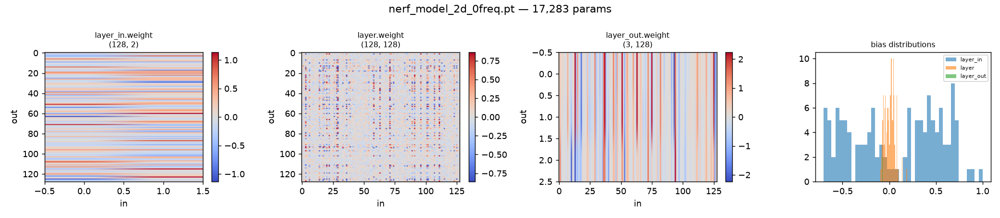
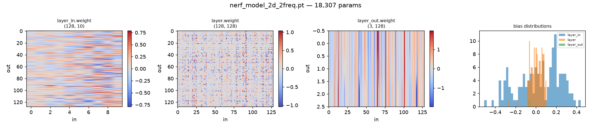
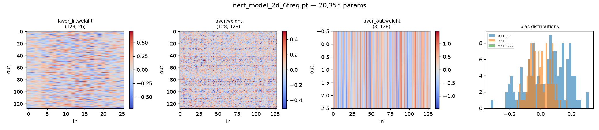

**3D NeRF model** — all 11 layers, including the skip connection at
`layer_6` (input width 319 = 256 from the trunk + 63 from the
re-injected positionally-encoded point) and the density head `layer_s`
(width 256 → 1):

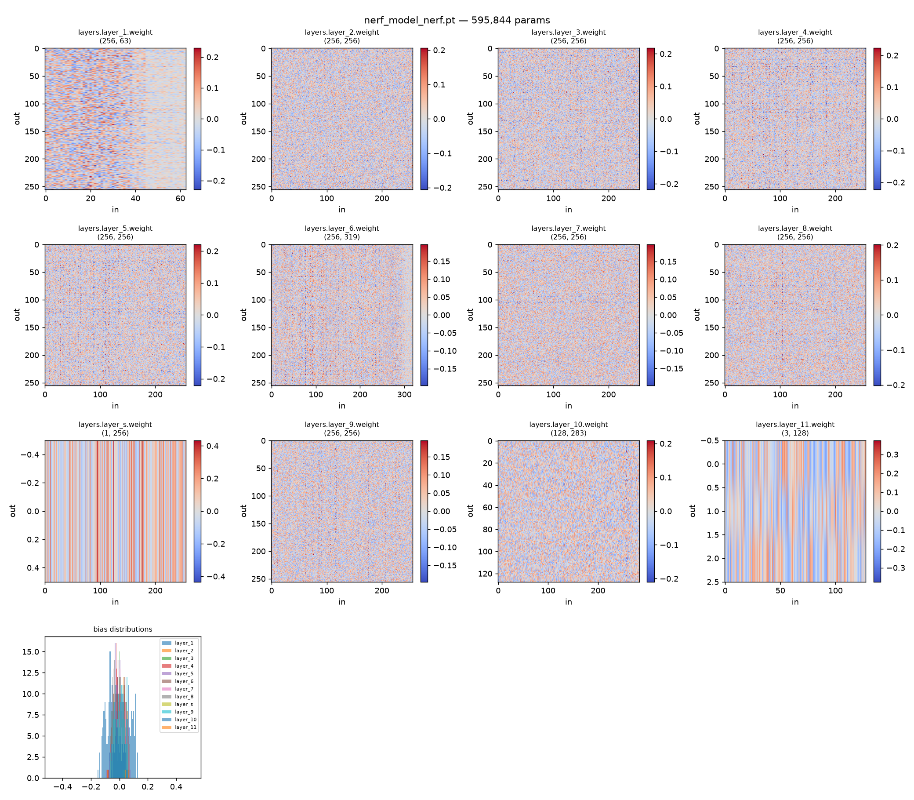

### Demo

**Part 2 — 3D NeRF, turntable render from the trained model:**

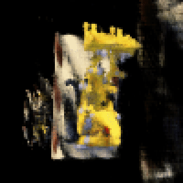

(full quality: `nerf_turntable.mp4`)

**Part 1 — 2D case, same target image reconstructed at increasing
positional-encoding frequency:**

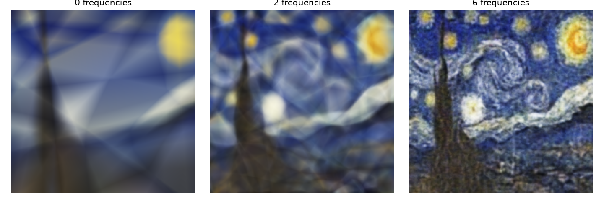

Individual reconstructions (same three results as above, saved standalone):

| 0 frequencies | 2 frequencies | 6 frequencies |
|---|---|---|
| 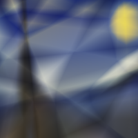 | 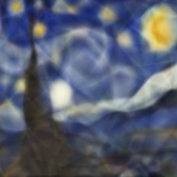 | 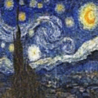 |

### Core concepts

**Positional encoding.** A plain MLP struggles to represent high-frequency
detail (sharp edges, fine texture) when fed raw low-dimensional
coordinates — this is the well-known spectral bias of neural networks
toward smooth, low-frequency functions. The fix: lift each input
coordinate `x` into a higher-dimensional space by applying `sin`/`cos` at
geometrically increasing frequencies:

```
γ(x) = [x, sin(2⁰πx), cos(2⁰πx), sin(2¹πx), cos(2¹πx), ..., sin(2^(L-1)πx), cos(2^(L-1)πx)]
```

Each extra frequency band (`L`) gives the network more high-frequency
basis functions to compose its output from, at the cost of a wider input
layer. That's exactly what the frequency-comparison image above shows: at
`L=0` (no encoding) the network can only reconstruct smooth blobs; by
`L=6` it recovers the fine brushstroke texture.

**2D case (`nerf_part1_code.py`).** The network itself is a plain 3-layer
MLP (`model_2d`): encode every normalized pixel coordinate
`(x, y) ∈ [0,1]²`, feed it through the MLP, and train against the
ground-truth RGB at that pixel. There's no camera or geometry involved —
it's a minimal testbed for "can an MLP + positional encoding memorize a
2D signal," which is the same question NeRF answers in 3D.

**3D case (`nerf_part2_code.py`).** Four pieces compose into one renderer:

- `get_rays` — for every pixel, use the camera intrinsics and the
  camera-to-world pose to compute the ray origin and direction in world
  space.
- `stratified_sampling` — pick a set of depth values between `near` and
  `far` along each ray and turn them into 3D query points.
- `nerf_model` — an 8-layer MLP (following the NeRF paper's architecture)
  that maps a positionally-encoded 3D point + viewing direction to a color
  (RGB) and a volume density (sigma). Position uses a richer encoding
  (`L=10`) than direction (`L=4`), since geometry needs more detail than
  view-dependent shading. There's a skip connection that re-injects the
  encoded position partway through the network, and density is predicted
  before the viewing direction is even considered — density must depend
  only on position, not on which way you're looking at a point.
- `volumetric_rendering` — turns the per-sample (color, density) pairs
  along a ray into a single pixel color, by treating density as a
  probability of a ray terminating at that point and alpha-compositing the
  colors front-to-back (the classic emission-absorption volume rendering
  integral, discretized).

`get_batches` just chunks the ray points so a full-resolution image's
worth of samples doesn't need to fit in memory/VRAM at once, and
`one_forward_pass` wires all of the above together for a single camera
pose: rays → samples → network → composited image.

### Reproducing the demo

The turntable render was generated by loading `nerf_model_nerf.pt`, which
(by inspecting the checkpoint's layer shapes) turned out to be trained
with `filter_size=256, num_x_frequencies=10, num_d_frequencies=4` — the
original NeRF paper's defaults. The object is the classic NeRF "Lego
bulldozer" synthetic scene. Since the original training camera poses
weren't available, the render uses a hand-probed spherical camera path
(`radius=1.5`, `near=0.3`, `far=3.5`) found by sweeping viewpoints until
the object was recognizable — which is also why the render is a
limited-angle pan rather than a full 360° orbit: reconstruction quality
drops off sharply outside the range of views the model actually saw
during training, a direct, visible illustration of how NeRF only
generalizes within its training view distribution.

---

## Two-View Stereo

A classic two-view stereo pipeline: rectify a calibrated image pair,
estimate a disparity map by patch matching, back-project disparity to a
3D point cloud, and clean up the result.

### Demo

Run end-to-end on two views from the Middlebury `templeRing` sequence:

**Inputs and intermediate outputs:**

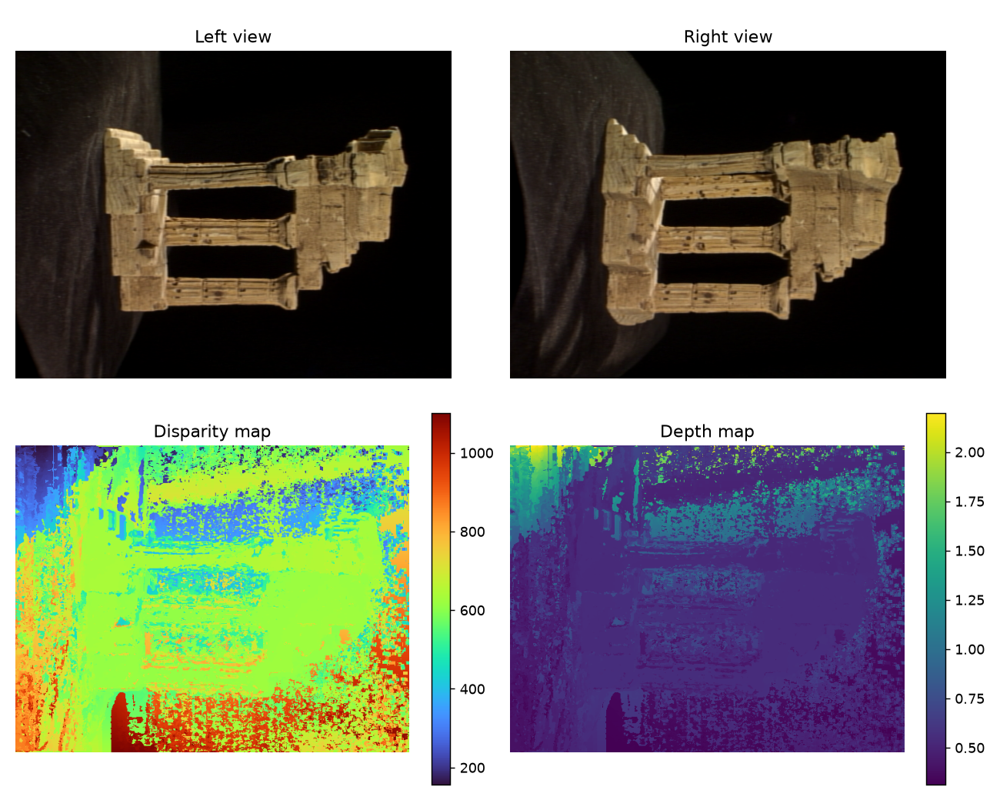

**Reconstructed point cloud, rotating:**

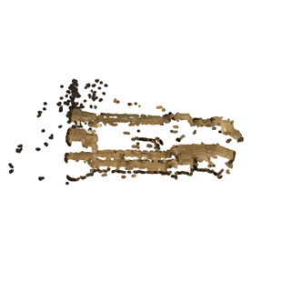

(full quality: `stereo_pointcloud.mp4`)

The three horizontal bars visible in the reconstructed point cloud are
the temple structure's colonnades — the same shape visible in the left
and right input views above.

### Core concepts

**Why rectify first.** Matching a point in the left image against every
pixel in the right image is a 2D search. Stereo rectification applies a
rotation to each camera so that corresponding points fall on the same
image row — collapsing the search to 1D, along a single scanline
(`compute_rectification_R`, `rectify_2view`). The rotation is built so
the epipole (the direction between the two camera centers) aligns with
one image axis.

**Disparity by patch matching.** For each pixel on a scanline in the
rectified left image, `compute_disparity_map` compares a small patch
around it (`image2patch`) against every patch on the same scanline in the
right image, using a similarity score — sum of squared differences
(`ssd_kernel`), sum of absolute differences (`sad_kernel`), or zero-mean
normalized cross-correlation (`zncc_kernel`, more robust to brightness/
contrast differences between the two views). The horizontal pixel offset
to the best match is the disparity. A left-right consistency check
(matching right→left should recover the same pixel) flags unreliable
matches.

**Disparity → depth → point cloud.** Disparity relates to depth by
`depth = baseline * focal_length / disparity` — closer points produce
larger disparities (`compute_dep_and_pcl`). Each pixel's depth plus its
image-plane position is enough to back-project it into a 3D point in the
camera frame via the inverse camera intrinsics.

**Cleanup.** `postprocess` masks out points using an HSV foreground
segmentation (drop the background drape/backdrop), a plausible depth
range, and the left-right consistency mask, removes statistical outliers
via Open3D, and transforms the surviving points from the camera frame
into world coordinates using the camera pose.

### Pipeline entry point

`two_view(view_i, view_j, k_size, kernel_func)` in
`stereo_two_view_stereo.py` runs all of the above for one image pair and
returns the point cloud, its per-point color, the disparity map, and the
depth map. `stereo_dataloader.load_middlebury_data(path)` loads a
Middlebury-format sequence (images + `*_par.txt` calibration) into the
`{"rgb", "R", "T", "K"}` view dicts this pipeline expects, and
`stereo_utils.viz_camera_poses(data)` plots the camera rig in 3D.
